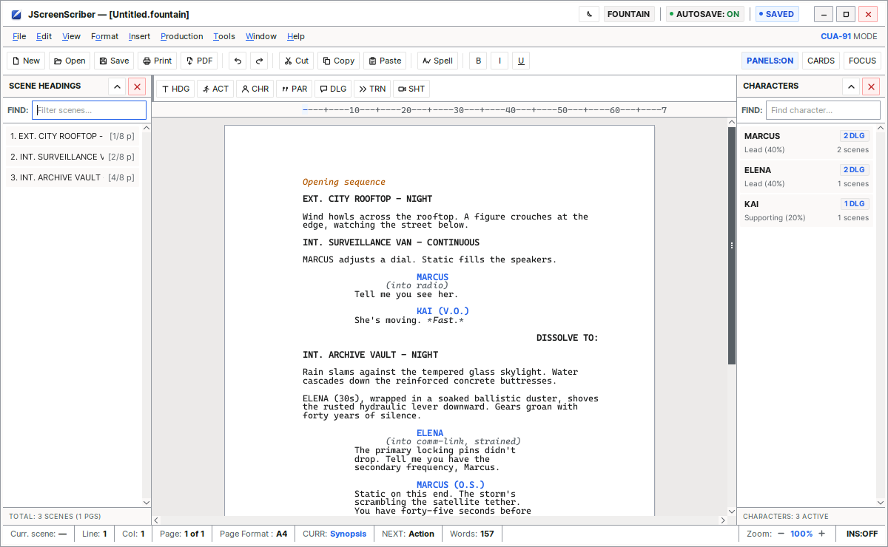
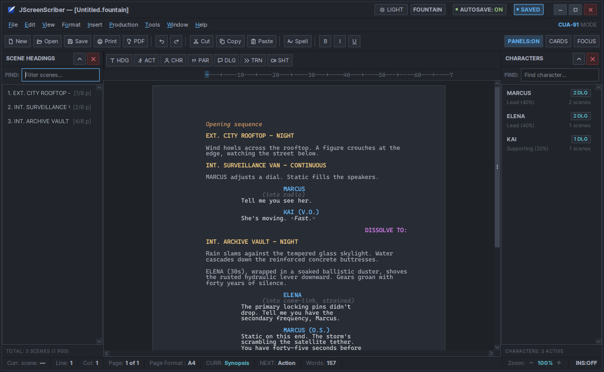

# JScreenScriber Desktop - Screenplay Editor for PC

## Summary

**JScreenScriber Desktop** is a screenplay writing application for the PC, written in Java (Swing + FlatLaf). It offers a true page view for writing, saves in the open **Fountain** format, supports A4 and Letter page sizes for both view and print, and includes a title page designer and direct PDF export.

## Development Status

#### Note : Vibe Coded, In-Development - Bugs may exist - Use with caution - Report Bugs and Feature Requirements!!!

  

---

## ❤️ Support This Project

If you enjoy using this software, you can support
its continued development!

### 🍕 Buy Me a Pizza  
<a href="https://buymeacoffee.com/sahasrarachakra?l=en">
  
</a>


## If you are an Indian Supporter
### 🇮🇳 Support via UPI

Scan this QR code using Google Pay, PhonePe or Paytm.


Thank you for supporting open-source development!

---

## Screens


### Light Mode


### Dark Mode



## Features

- Page view screenplay editor with proper script formatting
- Reads and saves **Fountain** (`.fountain`) files
- **A4** and **US Letter** page sizes for view and print
- Title page designer
- Direct **PDF export** from the toolbar
- Settings window with page margins and custom element styles
- Custom title bar, resizable from every edge, status bar with zoom and insert-mode indicators
- FlatLaf styling driven by `.properties` theme files
- Inter UI font and Cascadia Mono script font

## Prerequisites for Running

- Windows, Linux or macOS
- **Java 17 or later** (JRE or JDK) - check with `java -version`
- A screen resolution of at least 1280 x 720

## How to Run

1. Download the latest release (`JScreenScriber-Desktop.jar`) from the **Releases** page of this repository.
2. Make sure Java 17 or later is installed (`java -version`).
3. Double-click the `.jar` file, **or** run it from a terminal:

```bash
java -jar JScreenScriber-Desktop.jar
```

> On Windows you can also create a shortcut to `javaw -jar JScreenScriber-Desktop.jar` to start it without a console window.

## How to Use

1. **File → New** to start a script, or **File → Open** to load a `.fountain` file.
2. Write in the page view; use the element controls to switch between scene heading, action, character, dialogue, parenthetical and transition.
3. Open the **Title Page** designer to set title, author and contact details.
4. Choose **A4** or **Letter** and adjust margins and element styles in **Settings**.
5. Use the toolbar **PDF** button to export the screenplay directly to PDF.
6. Save regularly with `Ctrl + S`.

## Keyboard Shortcuts

| Shortcut | Action |
|---|---|
| `Ctrl + N` | New script |
| `Ctrl + O` | Open script |
| `Ctrl + S` | Save |
| `Ctrl + Shift + S` | Save As |
| `Ctrl + P` | Print |
| `Ctrl + E` | Export to PDF |
| `Ctrl + Z` / `Ctrl + Y` | Undo / Redo |
| `Ctrl + F` | Find |
| `Ctrl + Mouse Wheel` | Zoom |
| `Tab` | Cycle script element type |

<!-- Verify this table against the shortcuts actually implemented in your build. -->

## Prerequisites for Building

- **JDK 17 or later** (JDK 21+ recommended)
- **FlatLaf** library jar (place in `lib/`)
- An IDE such as NetBeans, IntelliJ IDEA or VSCodium, or just the command line
- Git

## How to Build

1. Clone the repository:

```bash
git clone https://github.com/SahasraraChakra/JScreenScriber-Desktop.git
cd JScreenScriber-Desktop
```

2. **Using an IDE:** open the project in NetBeans (or IntelliJ IDEA / VSCodium with Java extensions), make sure the project JDK is 17+, add the libraries from the `lib/` folder to the classpath, then choose **Run / Build**.

3. **Using the command line:**

```bash
# Windows (use ':' instead of ';' on Linux/macOS)
mkdir out
javac -cp "lib/*" -d out -sourcepath src src/com/jsoft/screenscriber/Main.java
jar cfe JScreenScriber-Desktop.jar Main -C out .
```

> Adjust the main class and paths above to match your project layout. Copy any resource folders (fonts, images, `.properties` themes) into the output before packaging, if your IDE does not do this automatically.

## Copyright

© JSoft Bharath, Kerala, India & Jeevan Kumar Vishwakarman. All rights reserved.

**JScreenScriber Desktop - Screenplay Editor for PC Developed By : JSoft Bharath, Kerala, India. / Jeevan Kumar Vishwakarman. All Rights Reserved To : JSoft Bharath, Kerala, India. / Jeevan Kumar Vishwakarman.**

## License

**Attribution-Required, No-Modification, No-Resale License**

Copyright © JSoft Bharath, Kerala, India & Jeevan Kumar Vishwakarman ("the Authors").

Permission is hereby granted, free of charge, to any person or organization obtaining a copy of this software and its source code ("the Software") to **use** the Software, for personal or commercial purposes, subject to the following conditions:

1. **Attribution is compulsory.** Any use of the Software, in any application, product, service, documentation or website, must display the following attribution text, in bold, in a place reasonably visible to users (for example an About dialog, credits screen, README or product page):

   **JScreenScriber Desktop - Screenplay Editor for PC Developed By : JSoft Bharath, Kerala, India. / Jeevan Kumar Vishwakarman. All Rights Reserved To : JSoft Bharath, Kerala, India. / Jeevan Kumar Vishwakarman.**

2. **No modification.** You may not change, modify, adapt, translate, decompile, reverse-engineer or create derivative works of the Software's code or binaries. The Software must be used exactly as distributed by the Authors.

3. **No selling or charging for the Software.** You may not sell, rent, sublicense, or charge any fee for the Software or its code, in whole or in part, or bundle it in a way that charges for the Software itself. You **may** charge for your own applications, products and services that use the Software, provided the Software itself is not what is being sold and condition 1 is met.

4. **Redistribution.** You may redistribute the unmodified Software free of charge only if this license, the copyright notice and the attribution text are kept intact.

5. **Ownership.** The Software is licensed, not sold. All rights not expressly granted are reserved by the Authors.

6. **Termination.** Any breach of these terms automatically terminates your rights under this license.

THE SOFTWARE IS PROVIDED "AS IS", WITHOUT WARRANTY OF ANY KIND, EXPRESS OR IMPLIED, INCLUDING BUT NOT LIMITED TO THE WARRANTIES OF MERCHANTABILITY, FITNESS FOR A PARTICULAR PURPOSE AND NONINFRINGEMENT. IN NO EVENT SHALL THE AUTHORS BE LIABLE FOR ANY CLAIM, DAMAGES OR OTHER LIABILITY, WHETHER IN AN ACTION OF CONTRACT, TORT OR OTHERWISE, ARISING FROM, OUT OF OR IN CONNECTION WITH THE SOFTWARE OR THE USE OR OTHER DEALINGS IN THE SOFTWARE.

For permission requests beyond these terms, contact the Authors via the repository's Issues page.
